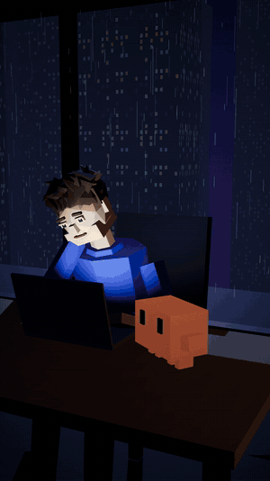

# lowpoly-reel

**Un skill Claude Code qui transforme un script en reel animé en 3D low-poly, prêt pour Instagram Reels et TikTok.**
*A Claude Code skill that turns a script into a low-poly 3D animated reel for Instagram Reels and TikTok.*

<p align="center"></p>

Tu donnes un script (qui parle, ce qui se passe à l'écran), Claude Code construit la scène, la fait jouer, génère les voix, monte le son et exporte la vidéo. Le style : un homme à son bureau la nuit, la pluie sur la vitre, la ville au loin, et un petit compagnon IA orange qui fait le travail sur un hologramme.

## Ce que ça fait

- **Animation 3D codée à la main** (Three.js), rendue image par image en 1080x1920 dans Chrome headless. Aucune image ni vidéo générée par IA.
- **Mise en scène** : plans variés (plan moyen, gros plan sur l'hologramme, plan large, très gros plan sur les yeux, plan visage pour l'émotion), lumière qui baisse dans le doute et se réchauffe quand l'assistant rassure.
- **Personnages animés** : posture, regard, clignements, bouche calée sur la voix ; le compagnon sautille quand il parle et s'agite quand il travaille.
- **Voix** avec ElevenLabs (via Claude in Chrome), puis animation recalée sur leurs vraies durées.
- **Son** synthétisé : pluie, sons d'interface, nappes, petits "pop", impact sur le logo, avec l'ambiance toujours sous les voix. Export à -14 LUFS.
- **Sous-titres**, carte de fin avec ton logo et un CTA adapté à chaque plateforme.
- **Contrôle qualité** : planche image par image avec les zones masquées par l'interface de Reels et TikTok, mesure de la loudness et de l'écart voix/ambiance.

## Installation

Prérequis : [Claude Code](https://claude.com/claude-code), Node 18+, Python 3 avec `numpy` et `scipy`, ffmpeg dans le PATH, Google Chrome ou Chromium. Pour les voix : un compte ElevenLabs et l'extension Claude in Chrome.

```bash
git clone https://github.com/stochosfrance/lowpoly-reel.git ~/.claude/skills/lowpoly-reel
```

## Utilisation

Dans Claude Code, colle ton script et demande un reel dans ce style, ou tape `/lowpoly-reel`. Exemple de script :

```
0:00-0:03  Il soupire, la tête sur la main    Lui : "Claude... j'ai la flemme de faire mes factures."
0:03-0:05  3 factures passent au vert          Claude : "Fini."
...
0:19-0:20  Il sourit, logo en fondu            Texte final : "Commente CLAUDE pour automatiser ton business."
```

Claude Code prépare un dossier de travail à partir de `template/`, génère les voix (si tu le demandes), écrit la timeline, te montre des aperçus, puis rend les versions Reels et TikTok dans `out/`.

## Personnaliser

En haut de `template/scene.js` :

- `BRAND` : nom, couleurs, textes de CTA par plateforme.
- `ASSISTANT` : nom et couleur de l'assistant.
- `assets/logo.png` (ou `.jpg`) : ton logo, clair sur fond sombre. Sans fichier, le nom de la marque est écrit en texte.
- `assets/assistant-logo.svg` : le logo officiel de l'assistant, à télécharger toi-même sur le site de la marque. Sans fichier, un simple point est affiché.

Les réglages de marque de ton projet (couleurs, CTA, dossiers de sortie) peuvent aussi vivre dans le `CLAUDE.md` du projet : le skill les lit en priorité.

## Fichiers

```
SKILL.md              instructions pour Claude Code
references/notes.md   pièges connus et commandes de contrôle
template/scene.js     la scène 3D, l'animation, les sous-titres, la carte de fin
template/render.mjs   rendu image par image (puppeteer + Chrome headless)
template/sound.py     ambiance sonore synthétisée
template/finalize.py  mixage voix + ambiance, loudness, export
template/recv.mjs     récupère les voix depuis l'onglet ElevenLabs
docs/demo.gif         l'extrait ci-dessus
```

## Bon à savoir

- Claude ne peut pas écouter le résultat : il mesure les niveaux, mais c'est à toi de valider les voix à l'oreille.
- Générer des voix consomme tes crédits ElevenLabs.
- Un rendu complet de 25 s prend quelques minutes selon la machine.

## Avertissement

Projet indépendant, non affilié à Anthropic ni à ElevenLabs. Claude est une marque d'Anthropic. Le dépôt n'inclut aucun logo de tiers ; si tu ajoutes le logo officiel d'une marque ou un personnage qui lui ressemble, assure-toi de respecter ses règles d'utilisation.

## English summary

`lowpoly-reel` is a Claude Code skill. Give it a short dialogue script and it builds a hand-coded low-poly 3D scene (Three.js, rendered frame by frame in headless Chrome), animates the characters, generates the voices with ElevenLabs, synthesizes the sound design, adds subtitles and a branded end card, and exports 1080x1920 H.264 reels for Instagram Reels and TikTok at -14 LUFS, with a safe-zone check. Install by cloning into `~/.claude/skills/lowpoly-reel`, then paste a script into Claude Code or run `/lowpoly-reel`. Not affiliated with Anthropic or ElevenLabs.

## Licence

[MIT](LICENSE)
